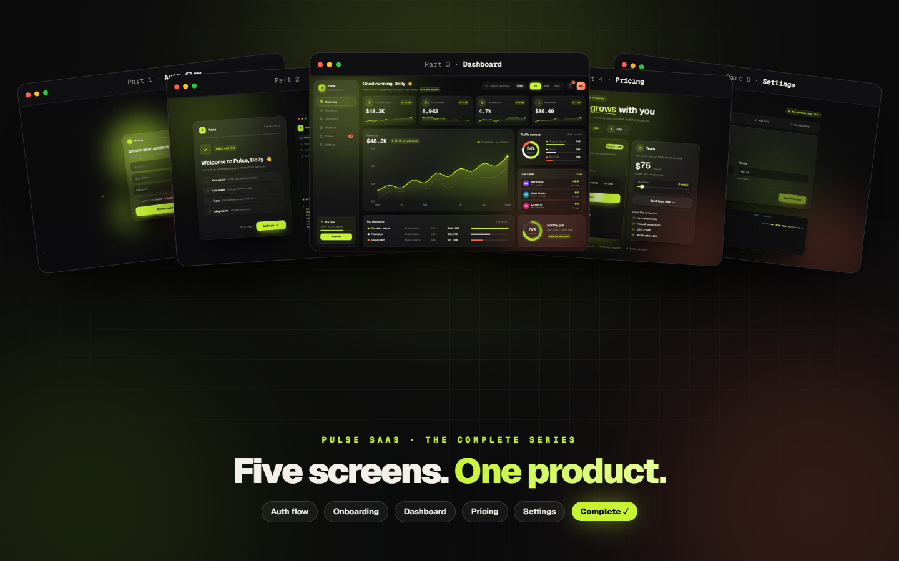

# Pulse Settings Panel

The settings screen of **Pulse**, a SaaS UI built in public, episode by episode: auth → onboarding → dashboard → pricing → **settings (finale)**.
Profile with real save states, team roles with an undo toast, API keys done right, auto-saving notifications, and built-in devtools.
Built with **Next.js 16 · TypeScript · Tailwind CSS v4 · Motion**.

**Live demo → [codewithdolly.vercel.app/settings](https://codewithdolly.vercel.app/settings/)**



## Features

- **Animated tabs:** Profile · Team · API keys · Notifications, with a sliding pill and blurred transitions.
- **Profile:** dirty-check → `Save changes` → saving spinner → drawn-check "Saved". The button disables itself when nothing changed.
- **Team:** role changes through a spring listbox (Admin / Member / Viewer with descriptions), remove with a **4s undo toast** (progress line included) that restores the member at their old position.
- **API keys:** generate (the secret is shown **once**, like real providers), reveal / hide, copy with feedback, and revoke behind an **inline confirm** popover. Secrets come from `crypto.getRandomValues`.
- **Notifications:** a channel matrix (Email / Slack / Push) of accessible switches that auto-save with a derived "Saved" pill.
- **Devtools panel:** every action is logged with real timings (`key.generate 850ms`, `member.remove`, `prefs.update`), the same pattern as the Pulse onboarding.
- **Finale recap:** call `window.__pulseFinale(true)` and all five Pulse screens fan in, ending on "Five screens. One product."
- **Accessibility:** `role="switch"` toggles, listbox menus with keyboard support, `aria-live` feedback, and `prefers-reduced-motion` respected through `MotionConfig`.

## Quick start

```bash
npm install
npm run dev      # http://localhost:3000
npm run build    # static export in ./out (deploy anywhere)
```

## Usage

```tsx
import { SettingsPanel } from "@/components/settings";

<SettingsPanel defaultTab="team" devtools={false} />
```

The pieces work on their own too:

```tsx
import { Switch, Select, Panel } from "@/components/settings";

<Switch checked={on} onChange={setOn} label="Weekly report via email" />
<Select value={role} options={ROLES} onChange={setRole} label="Role" />
```

Members, keys and notification defaults live in `src/components/settings/data.ts`. Replace them with your API.

## Structure

```
src/
  app/                     layout · page (demo) · globals.css (theme + animations)
  components/settings/     settings-panel · profile-tab · team-tab · api-tab · notifications-tab
                           pulse-finale · devtools · ui (Panel/Switch/Select/Avatar) · confetti · icons · data
public/recap/              the five Pulse screens used by the finale
```

## Theme

The colors are tokens in `src/app/globals.css` (`@theme`). Change them there.

Graphite `#0B0B0C` · Electric Lime `#C6F432` · Bone `#F2F0E9` · Smoke `#8A8A85` · Coral `#FF6B4A` · Font: Geist

## The Pulse series

1. [glass-auth-flow](https://github.com/dev-dollydiwakar/glass-auth-flow) — sign up → OTP → verified
2. [glass-onboarding-flow](https://github.com/dev-dollydiwakar/glass-onboarding-flow) — live preview + devtools
3. [pulse-analytics-dashboard](https://github.com/dev-dollydiwakar/pulse-analytics-dashboard) — the dashboard
4. [glass-pricing-section](https://github.com/dev-dollydiwakar/glass-pricing-section) — pricing & upgrade
5. **pulse-settings-panel** — this repo

## License

MIT. Free for personal and commercial projects.

---

Made by **Dolly Diwakar** · more production-grade UI on Instagram **[@codewithdolly_](https://instagram.com/codewithdolly_)**. A ⭐ helps a lot.
